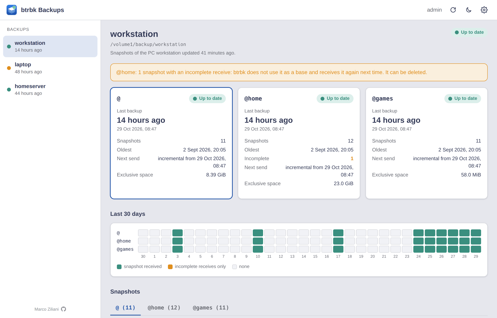
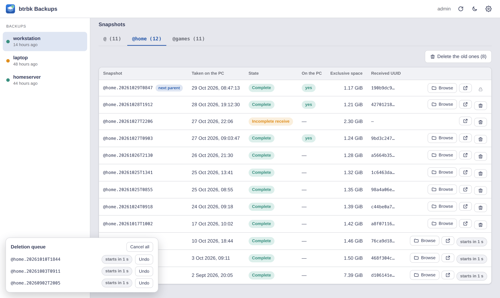
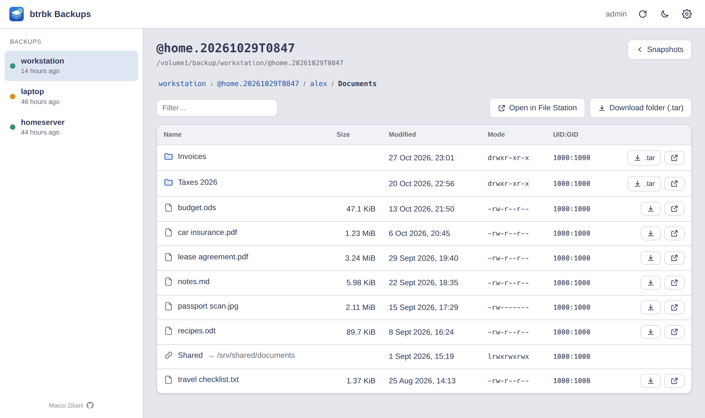
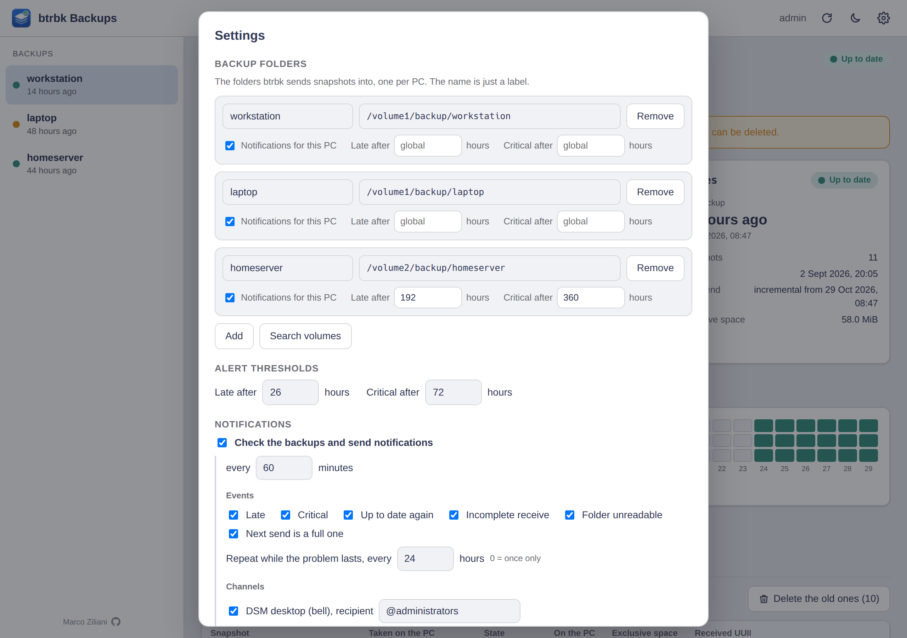
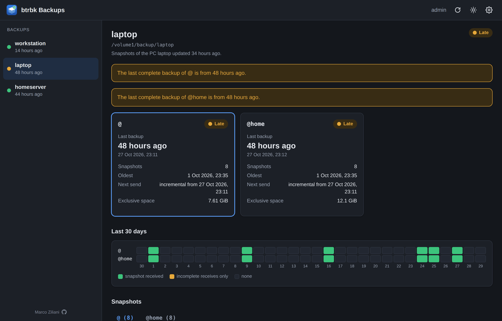

# btrbk-nas

A Synology DSM 7 package that shows the [btrbk](https://github.com/digint/btrbk)
backups a NAS receives: whether every subvolume is up to date, which receives
were interrupted, and the files inside any snapshot, ready to download, one
file or a whole folder as `.tar`.

It opens from DSM's main menu like any other app, uses the DSM login, and is
reserved to the `administrators` group. It speaks the language of the DSM
session: English, Italian, German, French, Spanish, Dutch, Portuguese
(Portugal and Brazil) or Polish, English for any other.



## What it shows

- **One page per sending PC** (one btrbk target directory each), with a card per
  subvolume: last complete backup, number of snapshots, oldest one, space only
  those snapshots hold (when quotas are on).
- **Freshness**: a subvolume is *late* after 26 hours without a complete backup
  and *critical* after 72; both thresholds are in the settings.
- **Anomalies**: interrupted receives (no received UUID, or still writable:
  btrbk calls them *garbled* and never uses them as a parent) and directories
  named like snapshots that are not subvolumes.
- **Last 30 days**, one row per subvolume.
- **Deleting old snapshots**, without breaking the chain: only those older
  than the common parent, and interrupted receives more than a day old (a
  younger one may still be running). A click queues a deletion; each waits 5
  seconds, during which it can be undone, then they run one at a time. The NAS
  checks every deletion again against fresh data, under a lock, whatever the
  page showed. Without the PC's report only interrupted receives can go.
- **File browser** inside any complete snapshot: owner, mode, size, symlinks
  shown but never followed; download of a file, or of a folder as a `.tar`
  stream. Interrupted receives are still writable and cannot be browsed.

Backup directories are found by themselves on first start: a share, or a
directory inside a share, holding subvolumes named like btrbk snapshots. Each
one can have its own thresholds (a PC that is not on every day) and its
notifications switched off.

<p align="center">
  
  
</p>
<p align="center">
  
  
</p>

*Snapshots with the next parent and a deletion queue; the files inside a
snapshot; settings; a late PC in the dark theme. The screenshots show made-up
data: `tools/screenshots.sh` takes them again.*

## Next incremental parent

btrbk's next send of a subvolume starts from the newest snapshot present on
both sides. The NAS alone cannot know which snapshots the PC kept, so the PC
tells it: after every btrbk run, `extras/pc/btrbk-nas-push-uuids` writes the
name, UUID and creation time of each local snapshot into the target
directory, as the hidden file `.btrbk-nas-source`. A PC snapshot's UUID is the
received UUID of its copy on the NAS, which makes the match exact.

With it the app shows, per subvolume, the next parent, the snapshots still
to send and which ones the PC still holds, and warns (and can notify) when
nothing is in common: the next send would transfer everything again.
The creation time shows when each snapshot was taken, to the second; snapshots
the PC no longer holds fall back to the minute in their name.

On the PC, as root:

```sh
install -m 755 extras/pc/btrbk-nas-push-uuids /usr/local/bin/
install -m 644 extras/pc/btrbk-nas-push-uuids.conf /etc/systemd/system/btrbk.service.d/
systemctl daemon-reload
```

The script reads everything from `/etc/btrbk/btrbk.conf`: the first volume, its
`snapshot_dir`, the first `ssh://` target, `ssh_user` and `ssh_identity`
(`BTRBK_NAS_*` variables override them). It runs as `ExecStopPost` of
`btrbk.service`, whether the run succeeded or not, and never makes the service
fail. Without it the app works as before, and says the parent is unknown.

Anything else that changes the PC's snapshots should run it too:

- [btrbk_tui](https://github.com/rylos/btrbk_tui) 2.10 runs root-owned hooks
  after a purge or a snapshot run (`I` does not go through `btrbk.service`):
  ```sh
  install -d -m 755 /etc/btrbk_tui/post-change.d
  ln -s /usr/local/bin/btrbk-nas-push-uuids /etc/btrbk_tui/post-change.d/50-btrbk-nas
  ```
- Any purge script of yours on the PC: call it after deleting.

The NAS takes the report on trust, as much as it trusts the PC: a PC that
lies about its snapshots can make its own older backups look deletable,
here and to `btrbk-nas-prune`. The PC can already delete them anyway: btrbk
deletes old backups on the target itself (`target_preserve`). Deleting from
the app still takes an administrator's click.

`extras/nas/btrbk-nas-prune` is the matching purge on the NAS side, for when
space has to be freed: it keeps the common parent read from
`.btrbk-nas-source` and everything newer, deletes what is older, and deletes
nothing without the report. Put it in the target directory (it works on the
directory it lives in, or `-d DIR`) and run it as root, `-n` first.

## Notifications

A small background process (`btrbk-nas daemon`, started with the package)
checks the backups every hour and notifies **changes only**: a subvolume
becoming late or critical, being up to date again, new interrupted receives,
a backup folder that cannot be read, no snapshot left in common with the PC.
While a problem lasts it reminds every
24 hours. Everything is in the settings and can be switched off: the whole
check, each event, each PC, the reminders, each channel. Stopping the package
in Package Center stops the check too.

Channels:

- **DSM desktop** (the bell), to `@administrators` or any user or group. DSM
  only accepts the package's own translated strings there, so the text is
  generic and the details are in the app, which a click on the notification
  opens.
- **Webhook**, off by default: the full text, to any URL. `{title}` and
  `{message}` are filled in, URL-encoded in the URL and JSON-escaped in the
  body; with no body the URL is called with GET (Telegram), with a body it is
  POSTed as JSON (ntfy, Discord, Home Assistant).

DSM's own notification rules (Control Panel > Notification) and their mail,
push and Telegram channels are not available: DSM refuses the `sysnotify`
worker that registers events there to packages not signed by Synology
(*non-synology-signed package should not use internal worker*).

## Install

Take `btrbk-nas-<version>.spk` from the
[releases](https://github.com/rylos/btrbk-nas/releases), or build it with
`./build.sh` (Rust with the `x86_64-unknown-linux-musl` target). Then, on the
NAS (x86_64, DSM 7):

```sh
scp -O btrbk-nas-*.spk admin@nas:
ssh admin@nas 'sudo /usr/syno/bin/synopkg install btrbk-nas-*.spk'
ssh admin@nas 'sudo /var/packages/btrbk-nas/target/bin/btrbk-nas setup'
```

Package Center's *Manual install* works too. **`setup` has to run again after
every install or upgrade**: the interface says so, with the command, when the
permissions are missing.

## How it works

DSM's web server runs `ui/api.cgi` once per request, as the package's own
unprivileged user. It execs the static `btrbk-nas` binary, which:

1. asks DSM's `authenticate.cgi` who is logged in, and refuses anyone outside
   `administrators`;
2. reads btrfs metadata with `TREE_SEARCH` and `INO_LOOKUP` ioctls. DSM runs a
   4.4 kernel with btrfs-progs 4.0, so the modern unprivileged
   `GET_SUBVOL_INFO` does not exist, and the output of such an old `btrfs`
   is no base to build on;
3. answers JSON, or streams a file or a `.tar`.

The ioctls need `CAP_SYS_ADMIN`, reading other users' files needs
`CAP_DAC_READ_SEARCH`, and deleting a snapshot - an entry of the target
directory - needs `CAP_DAC_OVERRIDE`. DSM 7 runs third-party packages as their own user and
refuses the `capabilities` field of `conf/privilege` for them (error 319,
*invalid package privilege content*). So the package installs without
privileges, and `btrbk-nas setup` (as root) writes the file capability on the
binary. No process runs as root: the CGI and the background check run as the
package user, with these capabilities.

They are held as little as possible. Both processes clear them as they
start; the CGI takes back only those its route needs, after the login
check (none for the settings, `CAP_DAC_OVERRIDE` only to delete), and the
background check never holds `CAP_DAC_OVERRIDE`. What is dropped cannot come
back in that process.

`setup` first gives the binary and the directories above it (`bin`, the
package's `target`) to root, binary executable only by the package's group
(`root:btrbk-nas 0750`): the package user cannot swap what an administrator
runs as root the next time. The file capability is written last, because
changing the owner drops it.

Inside a snapshot nothing is reached by path. The snapshot is opened once
and must be a read-only subvolume; every name below it is opened from the
directory already open, without following symlinks and without leaving the
subvolume. Replacing entries while a download runs cannot point it
anywhere else.

The webhook URL can hold a token: curl reads it from stdin, not from its
command line, which every local user can see.

After an upgrade the background process starts without capabilities: it
waits, without notifying errors, until `setup` has run, then restarts itself
to pick them up.

What the package deliberately does **not** do:

- **No parent chain from the NAS alone.** On a target, the parent UUID of a
  received snapshot names no subvolume the target holds (checked on DSM
  7.4.1): the next parent comes from the PC's report above. Deleting snapshots
  stays with the chain-aware purge of
  [btrbk_tui](https://github.com/rylos/btrbk_tui).
- **Nothing is written** to the backups, and nothing is deleted except the
  snapshots an administrator queues, with the checks above. It only writes in
  the package's own `var` directory: `config.json` (mode 0600, it can hold a
  webhook token), `monitor-state.json`, `monitor.log`, `monitor.pid`.

## Languages

The interface follows DSM's language (`SYNO.SDS.Session.lang`; DSM's codes
such as `ita`, `ger`, `ptb` map to ISO ones), and sends it with every
request, so the NAS answers its messages in it. Webhook notifications have
their own language, in the settings. A text a language lacks falls back to
English. Dates and numbers come from `Intl` in the same language.

| Path | What |
|---|---|
| `ui/lang/<code>.js` | the interface, by key; `en.js` is the reference |
| `src/lang/<code>.json` | the NAS's messages, keyed by the Italian of `t!("italiano {}", "English {}", x)`; built into the binary by `build.rs` |
| `ui/texts/<DSM code>/strings` | DSM desktop notifications (DSM only shows the package's own translated strings) |
| `spk/INFO.in` | `description_<DSM code>`, for Package Center |

```sh
tools/i18n-check.py --new sv   # start Swedish from the English: ui/lang, src/lang, ui/texts/sve
tools/i18n-check.py            # what is missing, unused, still English, or with other placeholders
```

Then add the language to `LANGUAGES` in `ui/app.js`. `cargo test` refuses
incomplete tables. The translations use DSM's own terms in each language,
from a glossary shared with [SynoFile](https://github.com/rylos/synofile)
(`docs/glossary.md` there); they were not reviewed by native speakers, and
corrections are welcome.

## Development

```sh
cargo test                                  # unit tests, including a GNU tar round trip
sudo tools/make-fixture.sh DIR              # loopback btrfs with received snapshots
cargo build && tools/devserver.py --sudo    # ui + CGI on http://127.0.0.1:8765
sudo env SYNOPKG_PKGVAR=target/devvar target/debug/btrbk-nas check --dry-run
sudo tools/make-fixture.sh -u DIR           # remove the fixture
tools/devserver.py --demo                   # the ui on made-up data, no btrfs needed
tools/screenshots.sh                        # the README screenshots, in headless Chromium
```

The development server replaces the DSM login with `BTRBK_NAS_DEV_USER`, which
only debug builds read. Point `target/devvar/config.json` at the fixture.

| Path | What |
|---|---|
| `src/btrfs.rs` | ioctls, ROOT_ITEM and qgroup decoding |
| `src/snapshot.rs` | btrbk snapshot names, scanning and discovery of targets |
| `src/api.rs` | routes, settings |
| `src/report.rs` | freshness and per-target summaries |
| `src/monitor.rs` | periodic check, notification rules, desktop and webhook |
| `src/source.rs` | the PC's list of its snapshots |
| `extras/pc/` | script and btrbk.service drop-in for the sending PC |
| `src/browse.rs` | path checks, listings, tar writer |
| `src/auth.rs`, `src/caps.rs` | DSM login, file capabilities |
| `src/lang.rs`, `src/lang/`, `ui/lang/` | languages, see above |
| `ui/` | the interface (no build step, no dependencies) |
| `tools/` | development server, btrfs fixture, demo data, screenshots |
| `spk/` | DSM package metadata |

## License

MIT, see [LICENSE](LICENSE).
